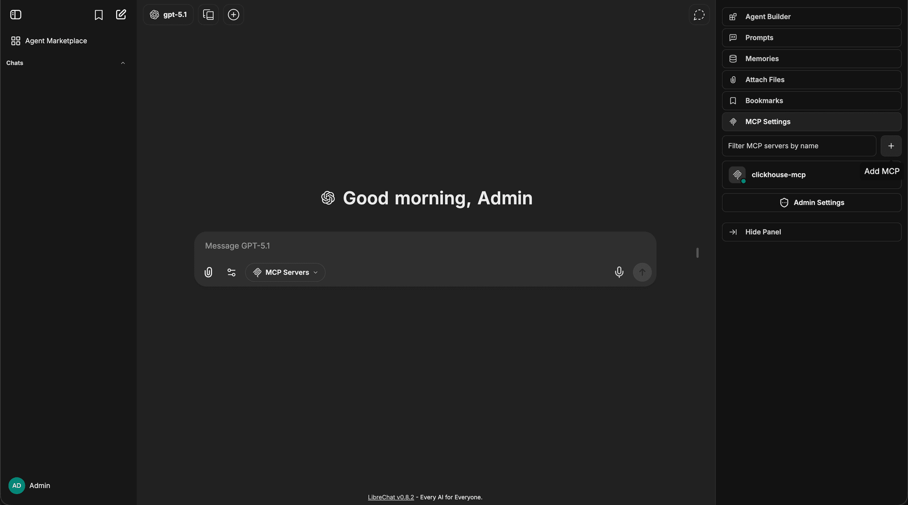
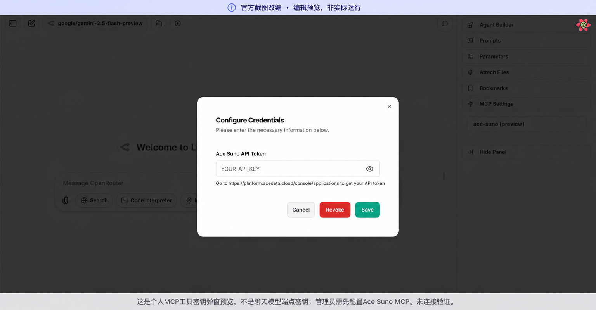

# LibreChat：Ace Data Cloud 单服务插件图文上手

Suno、Seedance、HappyHorse、GPT Image、Nano Banana 分别提供一个原生 Agent Plugin，品牌名在前、明确标注由 Ace Data Cloud 提供。不是第三方服务商或 LibreChat 官方出品。主源码复用已有 MCP，不复制生成/计费逻辑。

## 1. 选择并安装一个服务

官方安装机制见 [Agent Plugins](https://www.librechat.ai/docs/features/agent_plugins)。目前这是管理员文件系统安装机制，**不是全球官方商店**。当前源码 [PR #1](https://github.com/AceDataCloud/LibreChatPlugins/pull/1) 待审阅，尚未发正式版本。先取得 `codex/native-services-20261018` 分支的 checkout，再运行：

```bash
python3 scripts/install.py suno --plugin-dir /path/to/LibreChat/plugin
```

可分别换成 `seedance`、`happyhorse`、`gpt-image`、`nano-banana`。插件目录要挂载到 LibreChat 的 `/app/plugin`，保留已有挂载，重启该独立实例。只安装选择的服务，不必安装合集。随后用户在本实例 MCP/Skills 工具目录搜索服务名称。实验性格式必须与宿主版本相符；文件复制成功不等于已安装运行。

## 2. 注册、登录并获取正确 Key

打开 [Ace Applications](https://platform.acedata.cloud/console/applications?utm_source=librechat&utm_medium=referral&utm_campaign=evergreen&utm_content=plugins_zh_api_key)，注册或登录。找到 **General application**；没有时点击 **Initialize General Application**。检查服务权限、[当前价格](https://platform.acedata.cloud/models?utm_source=librechat&utm_medium=referral&utm_campaign=evergreen&utm_content=plugins_zh_pricing)与余额。

在应用卡片复制现有 API Key，或 **Keys / Manage Keys → Create** 为 LibreChat 创建独立 Key。按需设置过期、额度与 Allowed APIs；异步流程需包含生成和任务查询 API。


以上是真实 Ace 控制台截图，密钥已遮挡；沿用 [固定来源](../assets/tutorial/source.json)，不是 LibreChat 调用截图。免费试用额度以账户显示为准，不保证赠送。

## 3. 在 LibreChat 授权



官方产品截图显示 LibreChat v0.8.2 与其他示例服务，只说明设置位置，不证明 Ace 已安装或最新版本外观。

**原生插件 OAuth 路线：** 用户打开 **+ → MCP Servers** 或 **MCP Settings**，选择安装的服务并连接，在同一浏览器会话完成 Ace 登录授权。插件里只有 HTTPS 地址，不带共享 Key；实际登录仍需在指定版本验证。

**独立个人 Token 配置路线：** OAuth 无法使用时，管理员可以按官方 MCP 文档另外在 YAML 中配置敏感 `customUserVars` 字段。用户只把原始 API Token 粘贴到该服务的 MCP 密钥框；不加 `Bearer `，不使用 `platform-...` 管理 Token，不粘进聊天提示。YAML 同名 server 会覆盖插件项，不同时配置固定 header 与 OAuth。



这是 **2026-10-17 官方原图改编**，说明可选个人 MCP Token 路线，不是 OAuth 或聊天端点密钥窗口。原图日期/版本未标；不能证明 Ace 认证、调用、上线。聊天模型的 Key 需选择聊天端点后另填。

## 4. 首次使用与同 ID 结果

先确认工具出现、认证连接和 tools/list。静态工具说明不能证明服务余额或真实生成。若有本人已有成功 task ID，只读取同一个 ID。通过聊天模型触发工具可能另有模型费用，免费连接验收不要发送模型消息。

新生成必须先核选定模型、输入、当前价格和明确额度；只提交一次，保存 task ID，之后查询同 ID 至终态。pending、预览媒体、绿色工具状态都不等于最终成功。失败终态停止轮询；最终媒体与唯一账单分别核对。本轮没有新发付费生成。

## 常见问题

- 看不到服务：检查宿主支持 Agent Plugins、插件是目录直接子项、容器挂载与重启、启动日志。
- 401/403：检查 Token 类型、权限、过期、余额和具体审核错误，不擅自换账户或服务。
- pending：仅查同 ID，不重跑生成；429/超时先查原任务，不自动付费重试。
- GPT Image 包复用 OpenAI MCP，实际还含其他 OpenAI 工具；Skill 不是权限沙箱，需用 Allowed APIs 限制需要的操作。

[English](../README.md) · [隐私](../PRIVACY.md) · [问题反馈](https://github.com/AceDataCloud/LibreChatPlugins/issues)。源码、包、官方收录、安装、调用、终态账单和增长数据独立验收。
